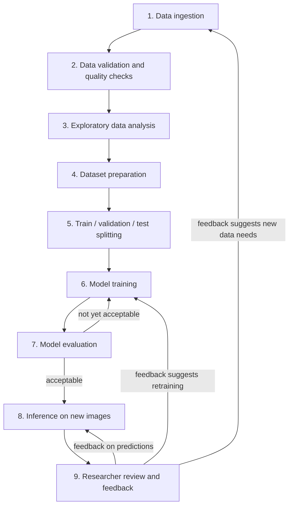

# Project Workflow

This document describes the proposed end-to-end workflow for Eelgrass
Intelligence, from raw imagery arriving from CERI through to researchers
acting on model predictions. It stays at the conceptual level: no code,
tooling, libraries, or model architectures are named here, and nothing below
assumes facts about CERI's dataset that have not yet been confirmed (see
`data_questions_for_ceri.md`).

Every stage description below is marked with a status:

- **Confirmed** — agreed as a project requirement (from `README.md` or
  `architecture.md`).
- **Proposed** — a reasonable design idea for how to meet a confirmed
  requirement, not yet agreed or committed to.
- **Open question** — cannot be designed at all until CERI provides
  information. Where a stage has open questions, the specific question is
  linked back to `data_questions_for_ceri.md` rather than repeated here.

Because almost nothing is known yet about CERI's dataset, most stages below
are marked **Proposed**, and most of their detail is provisional. This
document should be revisited and corrected once CERI's answers arrive.

## Workflow diagram

The two feedback loops (back into training, and back into ingestion) are
deliberate: this is not meant to be a one-way pipeline. Researcher feedback
is expected to influence both future model iterations and what data is
collected next.

The loop from model evaluation back into training (Stage 7 to Stage 6)
represents iterative development guided by training and validation results.
It is not intended to represent repeated reuse of final test-set results —
see Stage 7 for that distinction.

## Stage 1 — Data ingestion

**Status: Proposed**, within the confirmed principle that raw data is
immutable (`architecture.md`, Layer 1).

**Purpose:** Bring CERI's imagery and labels into the project in a
consistent, traceable way, without altering the originals.

**Expected inputs:** Raw image files and whatever label files or records
accompany them, as provided by CERI, plus any available metadata (e.g. site,
date, depth — see open questions below).

**Expected outputs:** An unmodified, versioned copy of the raw data,
alongside a record of *when* and *from where* each batch was ingested.

**Considerations:**

- Raw data should never be edited in place; anything derived from it must be
  regenerable, per the Layer 1 principle in `architecture.md`.
- Ingestion should tolerate incremental delivery — CERI may send data in
  batches over time rather than as one complete set.
- **Open questions blocking real design here:** what a single "sample" is,
  the capture protocol, image format/resolution, available metadata, total
  volume, and any data-sharing or sensitive-location constraints. See the
  "About the imagery" section of `data_questions_for_ceri.md`.

## Stage 2 — Data validation and quality checks

**Status: Proposed**, within the confirmed principle that this layer must
fail loudly on bad data rather than let it propagate (`architecture.md`,
Layer 2).

**Purpose:** Confirm that ingested data actually matches an agreed schema
before anything downstream trusts it.

**Expected inputs:** Raw ingested data from Stage 1.

**Expected outputs:** Either a validated dataset that later stages can rely
on, or an explicit rejection/report identifying what failed validation and
why.

**Considerations:**

- Checks would plausibly include: file integrity (unreadable/corrupt
  images), presence of expected metadata fields, label files that
  reference image files correctly, and labels that conform to an agreed
  format.
- This stage cannot be meaningfully designed until CERI's label format and
  schema are known — see the "About label format and tooling" section of
  `data_questions_for_ceri.md`.
- Any quality control or inter-annotator agreement information CERI can
  share would inform whether additional trust-related checks are needed
  here (e.g. flagging low-agreement labels rather than rejecting them
  outright).

## Stage 3 — Exploratory data analysis

**Status: Proposed.** Not yet discussed in existing docs, but a natural
step between "data is validated" and "data is prepared for modeling."

**Purpose:** Build an evidence-based understanding of the dataset — class
balance, image quality/variability, metadata distributions — before making
any modeling decisions, so those decisions are grounded in what the data
actually looks like rather than assumptions.

**Expected inputs:** The validated dataset from Stage 2.

**Expected outputs:** A descriptive summary of the dataset (e.g. how common
eelgrass presence is, how cover types are distributed, how imagery varies
by site/date/condition) intended for both the project team and CERI
researchers to review.

**Considerations:**

- This is where questions like class balance and rarity of minority cover
  types (raised in `data_questions_for_ceri.md`, "About structure and
  evaluation") get answered empirically rather than guessed.
- Findings here should directly inform Stages 4–6 — for example, severe
  class imbalance would affect dataset preparation and evaluation design,
  not just be noted and ignored.
- This stage is a good point to share findings back with CERI, since they
  may reveal that the data doesn't match what was informally expected.

## Stage 4 — Dataset preparation

**Status: Proposed.**

**Purpose:** Turn the validated, understood dataset into a form structured
around the actual research tasks (presence/absence, percentage cover,
cover-type), without yet splitting it for training.

**Expected inputs:** Validated dataset (Stage 2) plus EDA findings
(Stage 3).

**Expected outputs:** A task-oriented dataset representation — e.g.
images paired with the specific label(s) relevant to each task — ready for
splitting.

**Considerations:**

- What this stage actually involves depends entirely on how each task's
  labels are structured, which is unknown. For example, if percentage
  cover must be derived from segmentation masks rather than read directly,
  that derivation would happen here — but only once it's confirmed such
  masks exist (see "About percentage cover" in
  `data_questions_for_ceri.md`).
- If the three tasks (presence/absence, percentage cover, cover-type) turn
  out to need different subsets of the data (per `architecture.md`, Layer
  3), this stage may need to produce more than one task-specific dataset.

## Stage 5 — Train / validation / test splitting

**Status: Confirmed requirement** (held-out test set, leakage-aware
splitting — `architecture.md`, Layer 3), **proposed mechanics**.

**Purpose:** Divide the prepared dataset so that model performance can be
measured honestly, without data leaking between images used to build the
model and images used to judge it.

**Expected inputs:** Task-oriented dataset(s) from Stage 4.

**Expected outputs:** Three disjoint subsets per task — training,
validation, and test — plus a record of exactly how the split was made, so
it is reproducible.

**Considerations:**

- The test set must not be used to make any modeling decisions
  (`architecture.md`, Layer 3) — it exists purely for final evaluation.
- Splitting must account for grouping structure (e.g. multiple images from
  the same site, transect, or survey day) to avoid leakage — but whether
  such grouping exists, and at what granularity, is an open question (see
  "About structure and evaluation" in `data_questions_for_ceri.md`).
- Class balance findings from Stage 3 may inform how splits are
  constructed, but preserving meaningful separation between groups and
  preventing leakage (e.g. across site, transect, or survey day) takes
  priority over ensuring every rare class appears in every subset. If a
  rare class ends up absent from a subset, or its representation is
  limited, this should be documented as an evaluation limitation rather
  than addressed through a split that risks leakage.

## Stage 6 — Model training

**Status: Confirmed requirement** (versioned, reproducible experiments —
`architecture.md`, Layer 3). **No architecture or technique choices are
proposed here** — those depend on task formulation, which depends on label
structure, which is unknown.

**Purpose:** Fit a model to the training data for a given task.

**Expected inputs:** Training (and validation) subsets from Stage 5, and an
explicit, versioned configuration describing the experiment.

**Expected outputs:** A trained model artifact, plus a record of the exact
configuration and data version used to produce it, so the result is
reproducible.

**Considerations:**

- Each task's problem formulation (classification vs. regression vs.
  something derived from segmentation) must not be guessed —
  `architecture.md` is explicit that this depends on facts about CERI's
  labels not yet known.
- Training should be tracked as an experiment (configuration in, model +
  metrics out), not as an ad hoc, one-off script run, per the reproducibility
  principle in `architecture.md`.
- Model development is expected to be iterative: training may be repeated
  with different configurations, guided by training and validation results,
  until performance looks promising. This iteration happens *before* final
  evaluation — see Stage 7 for why the test set is deliberately kept out of
  this loop.

## Stage 7 — Model evaluation

**Status: Confirmed requirement** (evaluation on a held-out test set not
used for modeling decisions — `architecture.md`, Layer 3).

**Purpose:** Measure how well a trained model performs, using data it has
never influenced, and decide whether it's good enough to move toward
inference/use. This stage covers two distinct kinds of measurement, which
must not be conflated:

- **Validation-based evaluation**, used *during* model development for
  model selection, comparing configurations, and tuning (feeding back into
  Stage 6).
- **Test-based evaluation**, used *once*, after development decisions are
  complete, to produce a final, independent performance result.

**Expected inputs:** A trained model (Stage 6); the validation subset
(Stage 5), used repeatedly throughout development; and the test subset
(Stage 5), used only after development decisions are final.

**Expected outputs:** A set of performance metrics and, where useful,
qualitative review material (e.g. example predictions). During development,
this produces a decision to accept the current model configuration or
return to Stage 6 with a different one, based on validation results. At
final evaluation, this produces the model's reported test-set performance.

**Considerations:**

- Which metrics are meaningful depends on task formulation (unknown) and
  on what actually matters to CERI researchers for each task — this should
  be discussed with CERI, not decided unilaterally.
- Class imbalance (if confirmed present in Stage 3) would affect which
  metrics are trustworthy — e.g. plain accuracy can be misleading when
  eelgrass presence or a cover type is rare.
- The validation set may be used as many times as needed during
  development. The test set must not be — once it has been used for final
  evaluation, its results must not be used to repeatedly tune the same
  model. Doing so would compromise the independence of the final evaluation
  and make reported performance overly optimistic.
- If further development is judged necessary after the test set has
  already been used for final evaluation, a new independent test set — or
  another appropriately designed evaluation strategy — would be needed
  before reporting a new final performance result.
- This stage should also produce evidence CERI researchers themselves can
  inspect and judge, not only a single summary number, so the loop back
  from Stage 9 is meaningful.

## Stage 8 — Inference on new images

**Status: Confirmed requirement** (an interface for getting predictions on
new imagery — `README.md`, `architecture.md`, Layer 4). **Proposed
mechanics.**

**Purpose:** Apply an accepted, evaluated model to imagery it hasn't seen
before, producing predictions a researcher can use.

**Expected inputs:** New images (individually or in batches) and an
accepted trained model from Stage 7.

**Expected outputs:** Predictions for each image (per task), presented in a
form a non-ML researcher can interpret directly.

**Considerations:**

- Per `architecture.md`, Layer 4, this layer should stay as simple as
  possible until the data and modeling layers beneath it are stable —
  it should not be over-built ahead of that.
- Whether researchers will typically submit imagery immediately after a
  survey, in archived batches, or both, is an open question (see "About
  intended use" in `data_questions_for_ceri.md`) and would affect how this
  stage is designed.
- Reliability and observability (knowing when/why a prediction failed) are
  product requirements once this stage exists, per `architecture.md`.

## Stage 9 — Researcher review and feedback

**Status: Proposed.** Not yet discussed in existing docs, but implied by
the project's stated goal of being genuinely usable by CERI researchers
(`README.md`, Section 1).

**Purpose:** Give CERI researchers a way to review model predictions
against their own expertise, and capture their judgment in a form that can
improve the system over time — closing the loop rather than treating
inference as the final step.

**Expected inputs:** Predictions from Stage 8, reviewed by a researcher.

**Expected outputs:** Structured feedback — e.g. confirming, correcting, or
flagging predictions — that can feed back into: refining how predictions
are presented (back to Stage 8), a future training iteration (back to
Stage 6), or a realization that different/additional data is needed (back
to Stage 1).

**Considerations:**

- This stage only works if feedback is captured in a structured, reusable
  way rather than informal one-off comments — but what "structured" means
  here should be designed with CERI, since it depends on how researchers
  actually want to work.
- This is a natural point to surface model uncertainty or low-confidence
  predictions specifically for review, rather than presenting every
  prediction with equal confidence — though this is a design idea, not a
  commitment.
- Whether CERI already has baselines or prior heuristics researchers
  compare against (see "About intended use" in
  `data_questions_for_ceri.md`) would shape what researchers expect from
  this review step.

## Where CERI's input is needed before implementation

Nearly every stage above has design decisions that cannot be finalized
without CERI's input. In rough order of blocking impact:

1. **Stage 1 (ingestion) and Stage 2 (validation)** are blocked on the most
   basic questions: what a "sample" is, capture protocol, metadata, and
   label format/tooling.
2. **Stage 4 (dataset preparation) and Stage 5 (splitting)** are blocked on
   label structure per task and on whether/how images group by site,
   transect, or survey day.
3. **Stage 6 (training) and Stage 7 (evaluation)** are blocked on task
   formulation, which itself depends on the label questions above, and on
   which metrics matter to CERI.
4. **Stage 8 (inference) and Stage 9 (review)** are blocked on how
   researchers intend to use the tool day-to-day (real-time after a
   survey vs. archived batches) and on any existing baselines CERI already
   uses.

The full list of specific questions lives in `data_questions_for_ceri.md`
and should be treated as the authoritative, up-to-date source — this
document only maps those questions onto workflow stages.

## Status

This workflow is a proposed conceptual structure for discussion, not an
implementation plan. No stage should be built until the open questions that
block it are resolved with CERI, consistent with the principle in
`README.md`, Section 4.
